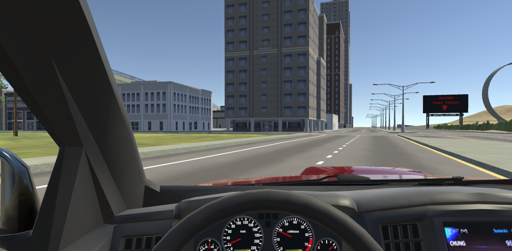

# VR Driving Simulation — Work Sampling Study

A VR-based car driving simulator built in Unity 6 using Vehicle Physics Pro and OpenXR, designed for a work sampling experiment comparing driver behaviour under clear vs. foggy road conditions with a Meta Quest headset.

This was a team project built during our internship. The goal wasn't just the simulator — we used it as a controlled environment to study driver cognitive states using work sampling methodology, then analyzed the data statistically in R.



---

## What it does

The simulator puts a driver in first-person VR inside a car. An automated observer (running in the background) samples the driver's state at random intervals — logging things like whether they're checking mirrors, braking, distracted, etc. We ran participants through two conditions: clear road and foggy road, then compared the work sampling data.

The physics and driving feel are handled by Vehicle Physics Pro. VR integration uses OpenXR with Meta Quest support via Unity's XR Interaction Toolkit.

---

## Tech stack

- Unity 6 (6000.6.8f1)
- Vehicle Physics Pro — car physics
- OpenXR + Meta Quest Support — VR
- XR Interaction Toolkit — input handling
- R — statistical analysis of work sampling data
- Python — data processing scripts

Hardware used: Meta Quest 2/3, NITTO Drive 1 Pro steering wheel (optional)

---

## Project structure

```
Assets/
  WorkSamplingObserver.cs   — automated observer, logs driver state at random intervals
  ExperimentManager.cs      — manages clear/fog conditions and trial flow
  CSVExporter.cs            — exports session data to CSV
  Quest3DrivingInput.cs     — Quest controller input handling
  SignalZone.cs             — triggers zone-based events on the track

analysis/
  analyze_work_sampling.py  — processes exported CSVs
  compare_runs.py           — compares clear vs fog runs

Exports/                    — sample data from our pilot runs
```

---

## Running the experiment

See [EXPERIMENT_GUIDE.md](EXPERIMENT_GUIDE.md) for the full protocol — how to set up a session, what the observer logs, and how to export and analyze data.

Short version:
1. Open in Unity 6
2. Enable OpenXR in XR Plug-in Management
3. Connect Meta Quest via Air Link or USB
4. Hit Play — the ExperimentManager handles the rest

---

## Controls

You can drive with just a Quest controller if you don't have a steering wheel. The NITTO Drive 1 Pro works in Xbox mode if you do have one.

| Input | Action |
|-------|--------|
| Left stick / steering axis | Steer |
| A button | Start engine |
| B button | Upshift |
| X button | Reverse |
| Y button | Neutral |
| LB | Respawn car |
| RB | Switch camera view |

---

## Notes

- The `Library/` and `Temp/` folders are gitignored — you'll need to let Unity reimport assets on first open (takes a few minutes)
- Project was originally Unity 2022, upgraded to Unity 6 — see `UNITY6_UPGRADE_CHECKLIST.md` if something breaks
- Pilot data from two runs is in `Exports/` for reference

---


GitHub: [kamal-6369](https://github.com/kamal-6369) · 
